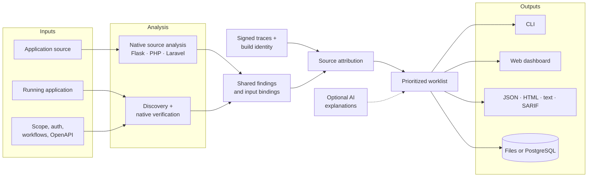
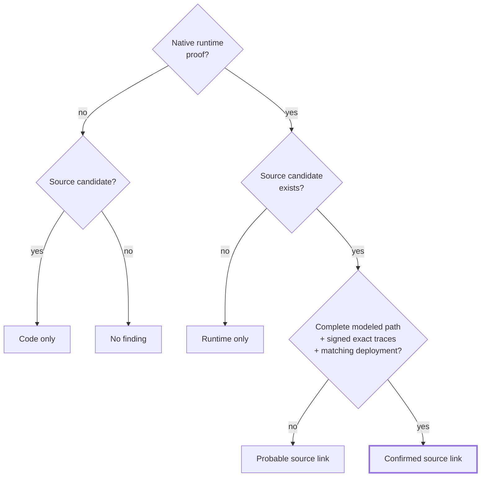
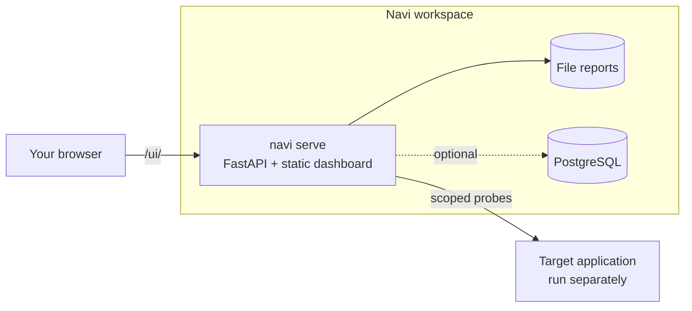

<div align="center">

# Navi

**Web application security scanner: native static analysis, runtime verification, and evidence-based source correlation.**

[](https://github.com/stealthwhizz/Navi/actions/workflows/test.yml)


[Quick start](#quick-start) · [How it works](#how-it-works) · [Reading results](#reading-results) · [Dashboard](#dashboard-and-storage) · [Docs](docs/README.md)

</div>

---

Navi analyzes Python/Flask, procedural PHP, and Laravel source, tests an independently running application, and ties runtime proof back to the exact line of code that caused it. Findings are reviewed through a CLI, a web dashboard, or portable JSON/HTML/text/SARIF reports. AI-assisted explanations are optional and never decide what is proven.

> [!IMPORTANT]
> Only scan applications you own or have written permission to test.

## Contents

- [Highlights](#highlights)
- [How it works](#how-it-works)
- [Vulnerability coverage](#vulnerability-coverage)
- [Quick start](#quick-start)
- [Commands](#commands)
- [Reading results](#reading-results)
- [CI integration](#ci-integration)
- [Dashboard and storage](#dashboard-and-storage)
- [Optional AI explanations](#optional-ai-explanations)
- [Repository layout](#repository-layout)
- [Development](#development)
- [License](#license)

## Highlights

| | |
|---|---|
| **SAST** | Tracks request inputs into sensitive operations with source locations, modeled protections, helper/service propagation, and bounded data-flow graphs. |
| **DAST** | Discovers forms and links or imports local OpenAPI inputs, then runs native verification probes against the configured target. |
| **Authenticated workflows** | Login/cookies, fresh form and CSRF controls, request seeds, object creation, ID/token extraction, and cleanup. |
| **Source attribution** | Connects runtime evidence to source operations via exact input bindings, modeled flow, signed operation/input traces, and deployment identity. |
| **Reports and triage** | Preserves payloads, controls, source snippets, confidence checks, severity, stable IDs, and scan history. |
| **Optional AI review** | Groq or OpenAI explain existing findings and suggest investigation steps. Model output cannot establish runtime proof or force a source link. |

Navi runs its own source analyzers and HTTP verifiers. It does **not** invoke Semgrep, Nuclei, or ZAP. Its local template interpreters support a documented subset of Semgrep-style PHP rules and Nuclei-style HTTP templates; the bundled starter pack is Navi-authored.

## How it works



Each stage has a hard evidence boundary:

- **SAST** produces candidates and modeled flow, never exploitability claims.
- **Runtime verifiers** establish observed behavior against baselines and negative controls.
- **Template matches** stay unverified unless independently reproduced.
- **Correlation** requires extra source, input, trace, and deployment evidence; AI cannot override it.

Component-level detail and the report schema live in [docs/ARCHITECTURE.md](docs/ARCHITECTURE.md).

## Vulnerability coverage

| Weakness | CWE | Source analysis | Runtime verification |
|---|---|---|---|
| SQL injection | [89](https://cwe.mitre.org/data/definitions/89.html) | Unsafe SQL construction and raw expressions | Repeated boolean comparisons and controls |
| Cross-site scripting | [79](https://cwe.mitre.org/data/definitions/79.html) | Unsafe HTML and supported Blade contexts | JavaScript execution in Chromium response replay |
| Command injection | [78](https://cwe.mitre.org/data/definitions/78.html) | Shell arguments and modeled quoting | Independent POSIX shell-marker probes |
| Path traversal | [22](https://cwe.mitre.org/data/definitions/22.html) | User-controlled file paths | Configured boundary-crossing file and unique marker |
| Open redirect | [601](https://cwe.mitre.org/data/definitions/601.html) | User-controlled destinations | Observed redirect to the supplied destination |
| Hard-coded credentials | [798](https://cwe.mitre.org/data/definitions/798.html) | Credential-like literal candidates | — credential validity is not tested |
| Object authorization / IDOR | [639](https://cwe.mitre.org/data/definitions/639.html) | — no general authorization inference | Operator-defined identities, objects, and access rules |

Coverage is bounded. See the [CWE matrix](docs/CWE_TEST_MATRIX.md), [PHP guide](docs/PHP_ANALYSIS.md), and [Laravel guide](docs/LARAVEL.md) for supported variants and known gaps.

## Quick start

### Requirements

| Dependency | Needed for |
|---|---|
| Python 3.11+ | Everything |
| PHP CLI with tokenizer | PHP and Laravel source analysis |
| Chromium (via Playwright) | XSS execution checks |
| Node.js 22+ | Building the optional dashboard |
| PostgreSQL | Optional scan history; file reports work without it |

### Install

```sh
python3 -m venv .venv
source .venv/bin/activate
python -m pip install -e '.[browser]'
python -m playwright install chromium
```

For CLI-only source analysis, `pip install -e .` is enough. Some Linux distributions need extra browser system packages; see [setup and troubleshooting](docs/PRODUCT_GUIDE.md).

### Scan

Start your application separately, then point Navi at it:

```sh
# Inspect the plan without contacting the target.
navi plan --source /path/to/application --target http://127.0.0.1:8000

# Combined source analysis and runtime checks.
navi scan --source /path/to/application --target http://127.0.0.1:8000 --no-ai

# Source analysis only.
navi scan --source /path/to/application --no-ai

# Runtime checks for an API without source.
navi scan --target http://127.0.0.1:8000 --openapi /path/to/openapi.json --no-ai

# Re-read a saved report without scanning.
navi report artifacts/report.json
```

Every scan is kept under `<output>/scans/<id>/`, and the latest `report.{json,html,txt,sarif}` and `events.jsonl` are copied to the output root.

### Scope and configuration

- `--config /path/to/scan.json` supplies authentication, valid input values, workflows, request budgets, and build identity. Start from the [generic configuration](examples/config/generic.json).
- Only GET is enabled by default. Opt in to others explicitly, e.g. `--allow-method POST`.
- Non-loopback targets require their exact origin: `--allow-origin https://staging.example.com`.
- PHP apps served from a subdirectory: `--document-root public`. Laravel: pass the repository root.

## Commands

| Command | Purpose |
|---|---|
| `navi scan` | Scan source, a running HTTP(S) application, or both |
| `navi plan` | List native test candidates without contacting the target |
| `navi doctor` | Check source, target, browser, and PostgreSQL readiness |
| `navi init` | Save a reusable project file (`navi.json`) without scanning |
| `navi report` | Explain a saved report without scanning or AI requests |
| `navi compare` | Compare two saved reports from the same project |
| `navi evaluate` | Score a report against a separately supplied answer key |
| `navi serve` | Start the FastAPI service and dashboard |
| `navi migrate` | Apply the PostgreSQL schema |
| `navi ai-check` | Check AI provider credentials using synthetic data only |

Run `navi <command> --help` for every flag.

## Reading results

Runtime verification (`verification`) and source attribution (`source_link`) are independent. Navi only merges a source and runtime finding into one **Confirmed** issue when every link in the evidence chain holds:



| Source-link state | Meaning |
|---|---|
| **Confirmed source link** | Native runtime proof, a complete modeled input-to-sink path, signed exact operation/input traces, and matching deployment identity. Source and runtime findings merge into one Confirmed issue. |
| **Probable source link** | Runtime behavior is verified and a source candidate exists, but attribution evidence is incomplete. Findings remain separate. |
| **Runtime only** | No supported source cause was established. Check `verification`: an ordinary HTTP template match is not verified exploitability. |
| **Code only** | A source candidate with no confirmed source/runtime association. |

The worklist orders Confirmed issues first, then by descending heuristic risk (not CVSS). Stable fingerprints let you compare scans, but a finding that disappears on a later scan is **not** proof of a fix.

Optional [Laravel tracing middleware](navi/integrations/laravel/NaviTrace.php) produces the signed traces. It must be wired in at the actual sensitive operations; it does not instrument an application automatically. See [accuracy and tracing setup](docs/ACCURACY.md).

## CI integration

```sh
navi scan --source . --target http://127.0.0.1:8000 --no-ai --fail-on-verified-high
```

| Flag | Fails the build when |
|---|---|
| `--fail-on-verified-high` | Any high/critical issue has runtime proof, including Runtime only issues |
| `--fail-on-confirmed-high` | Any high/critical issue is Confirmed (stricter source-link requirement) |
| `--require-complete` | Coverage is partial |

| Exit code | Meaning |
|---|---|
| `0` | Scan completed; no threshold tripped |
| `1` | A `--fail-on-*` threshold tripped |
| `2` | Configuration or environment error |
| `3` | Scan stopped early, or coverage partial with `--require-complete` |
| `130` | Cancelled or interrupted |

Use `--json-events` for machine-readable progress on stdout; SARIF output plugs into code-scanning tools.

## Dashboard and storage

```sh
cd UI && npm ci && npm run build && cd ..
navi serve --source /path/to/application --target http://127.0.0.1:8000
```



- The service serves the exported Next.js dashboard under `/ui/`, with scan progress, cancellation, issue evidence, source routes, and report history.
- Set `NAVI_API_TOKEN` to protect workspace access. It is a single configured workspace that runs one active scan at a time, not a multi-tenant service.
- Set `DATABASE_URL` for PostgreSQL history; otherwise reports stay on the filesystem.
- [`compose.workspace.yaml`](compose.workspace.yaml) runs the scanner and PostgreSQL with persistent volumes. It does **not** start the target application.

More in the [operating guide](docs/PRODUCT_GUIDE.md) and [UI guide](UI/README.md).

## Optional AI explanations

```sh
cp .env.example .env   # then set GROQ_API_KEY
navi ai-check --offline
navi scan --source . --target http://127.0.0.1:8000 --ai
```

- Disabled by default. The default model is `openai/gpt-oss-20b`; `--ai-provider openai` switches provider and key.
- Review uses bounded, redacted context and at most five provider attempts per scan.
- If the provider fails, native findings remain intact.

See [AI behavior](docs/AI.md).

## Repository layout

| Path | Contents |
|---|---|
| [`navi/`](navi) | Scanner engine, analyzers, native verifiers, correlation, CLI/API, reports, storage, templates, Laravel instrumentation |
| [`UI/`](UI) | Next.js/React dashboard source |
| [`tests/`](tests) | Unit, regression, and optional integration tests |
| [`examples/`](examples) | Generic configuration and small intentionally vulnerable/protected fixtures |
| [`benchmarks/`](benchmarks) | Hash-pinned external-source answer key and runner; target checkout supplied separately |
| [`scripts/`](scripts) | Setup, fixture replay, database checks, CI acceptance helpers |
| [`docs/`](docs) | Product, architecture, operation, configuration, and coverage documentation |
| [`.github/workflows/`](.github/workflows) | CI for Python, PHP, Chromium, frontend, and PostgreSQL |
| `Dockerfile`, `compose*.yaml` | Container build and workspace deployment |

Local `.env`, `.venv`, project settings, scan reports, build outputs, downloaded targets, and archives are git-ignored. Full third-party applications are not bundled; only the small fixtures the test suite needs.

## Development

```sh
python -m pip install -e '.[test]'
python -m pytest -ra
```

Browser, live HTTP, PHP SQLite, and PostgreSQL tests need their respective prerequisites and skip otherwise.

**Historical validation:** 555 passed, 14 skipped on the available host ([details](VALIDATION.md)). On a small reviewed DVWA source sample, Navi found four vulnerable operations and reported none of four protected controls. These results do not establish accuracy on unseen applications.

See [contributing](CONTRIBUTING.md), the [documentation index](docs/README.md), and the [architecture and report format](docs/ARCHITECTURE.md).

## License

A project-wide license has not been selected. The bundled template pack has its own [MIT license](navi/templates/packs/LICENSE), which does not cover the rest of the repository.
