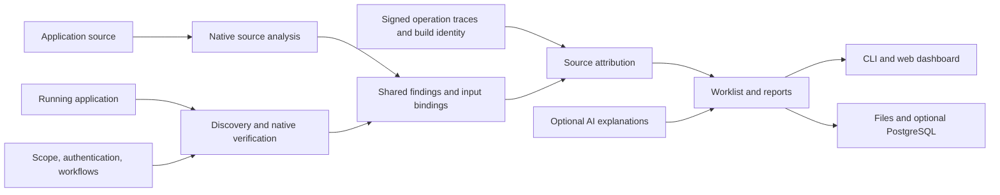

# Architecture

Navi uses a shared evidence model across source analysis, HTTP testing, correlation, reporting, and storage. Production scanners do not consume benchmark answer keys or depend on the bundled test applications.

## Components

| Location | Responsibility |
|---|---|
| `navi/engine.py` | Scan lifecycle, progressive events, evidence aggregation, exports, and history |
| `navi/model.py` | Versioned findings, bindings, routes, checks, and stable fingerprints |
| `navi/static.py` | Bounded Python/Flask analysis and source snapshot hashing |
| `navi/php.py`, `navi/php_paths.py` | PHP token analysis, input/sink rules, and exact include paths |
| `navi/laravel*.py` | Laravel routes, class/service dispatch, validation semantics, and Blade flow |
| `navi/source_flow.py` | Bounded per-input provenance graphs |
| `navi/discovery.py`, `navi/openapi.py`, `navi/candidates.py` | Runtime inputs from forms, links, API definitions, configuration, and source |
| `navi/runtime.py`, `navi/browser.py` | Native HTTP verification, browser replay, stored-XSS recipes, and configured authorization checks |
| `navi/transport.py`, `navi/control.py` | Scoped HTTP, TLS/address pinning, request limits, deadlines, and cancellation |
| `navi/workflows.py`, `navi/workflow_state.py` | Form refresh, session renewal, setup/extraction/substitution, and cleanup |
| `navi/templates/` | Local PHP/HTTP template interpreters and original starter packs |
| `navi/correlate.py`, `navi/tracing.py` | Exact source attribution, authenticated trace validation, and provisional link states |
| `navi/ai/` | Provider configuration, redacted context, bounded requests, and reviewed advice |
| `navi/worklist.py`, `navi/reasoning.py`, `navi/report.py`, `navi/console.py` | Prioritization, explanations, and JSON/HTML/text/SARIF presentation |
| `navi/cli.py`, `navi/project.py` | CLI commands, project settings, plans, and diagnostics |
| `navi/api.py`, `navi/ui.py`, `navi/server.py` | Protected workspace API, dashboard projections, and serving |
| `navi/store.py`, `navi/schema.sql`, `navi/lab.py` | Persistence, comparisons, and configured access-policy experiments |
| `navi/evaluate.py`, `benchmarks/` | Post-scan evaluation against independent answer keys |
| `navi/integrations/laravel/` | Optional request-bound PHP operation instrumentation |
| `UI/` | Next.js/React dashboard, built as a static export |

## Evidence boundaries

SAST produces candidates and modeled flow, not exploitability claims. Native runtime verifiers establish observed behavior with controls. Template matches remain unverified unless independently reproduced. Correlation requires additional source, input, trace, and deployment evidence; AI does not override those decisions.

The service runs one active scan per instance for one configured workspace. CLI jobs can run independently. File exports remain usable without PostgreSQL. Optional browser, database, or provider failures retain completed evidence and report incomplete coverage.

See [accuracy and tracing](ACCURACY.md), [CWE coverage](CWE_TEST_MATRIX.md), and [operation](PRODUCT_GUIDE.md) for detailed behavior.

## Report format

Reports use schema **1.2**. Source and runtime scanners share a finding shape; unavailable source is `null`, and source-only findings have no runtime observations.

| Field | Contents |
|---|---|
| `findings[]` | Stable `id`/`fingerprint`, `origin` (`sast` or `dast`), CWE, title, severity, source location/snippet, input bindings, verification, evidence, scanner/rule identity, and modeled `source_flows` |
| `runtime[]` on a finding | Recorded URL, method, input location/name, actual tested payload, request metadata, response, evidence index, and available browser/command/trace observations |
| `issues[]` | Correlated finding IDs, candidate source IDs, source-link reasons/checks, `source_link`, `evidence_graph`, fix suggestion, heuristic risk, and triage |
| `routes[]`, `function_map` | Supported source handlers, file/line ranges, and resolved/unresolved helper relationships |
| `checks[]`, `coverage` | Verified, not reproduced, inconclusive, skipped, and error outcomes, plus prerequisites and limitations |

Input locations remain distinct: query, form, JSON, path, header, cookie, and configured session values. Authentication headers are redacted; baselines and negative controls remain attached. No missing source location, payload, or proof is fabricated.

`verification` describes runtime proof independently of `source_link.status`. Only the full [source attribution requirements](ACCURACY.md) permit a Confirmed merge. Provisional candidates retain separate IDs. The queue orders Confirmed issues first, then descending heuristic risk; this score is not CVSS. Stable fingerprints support comparison across scans, and a finding that is not observed later is not automatically fixed.

JSON and SARIF retain structured evidence; HTML/text and the dashboard present it for review. The evaluator also accepts older schema 1.0 and 1.1 reports.
